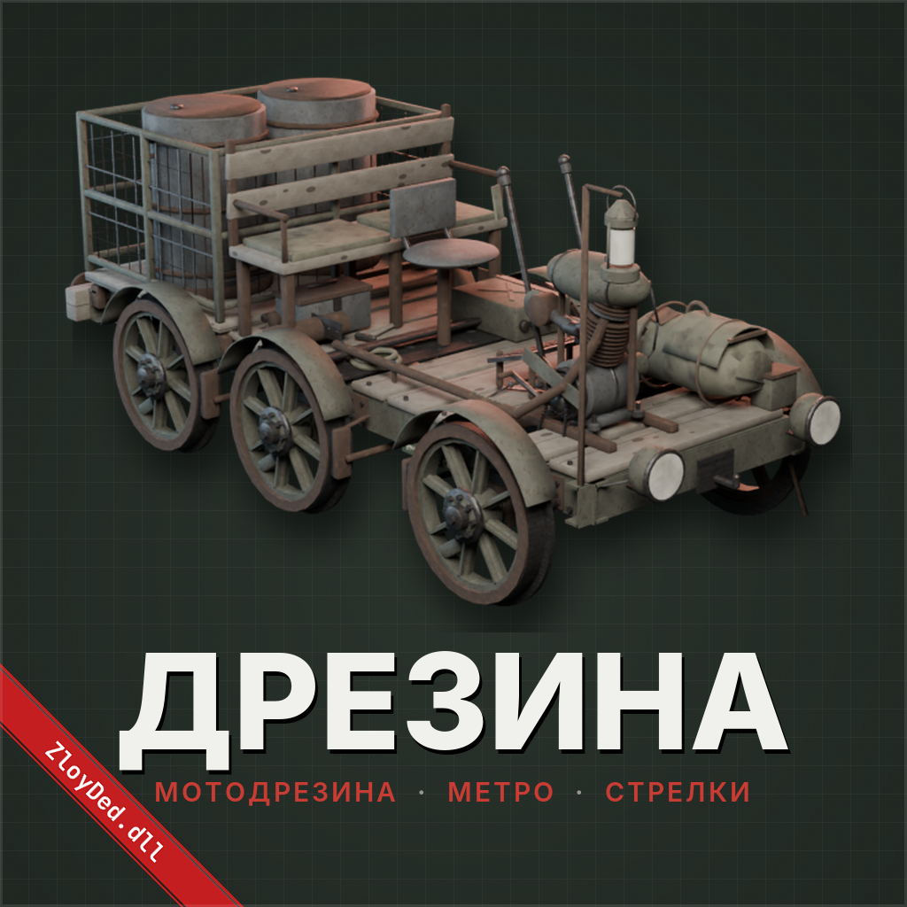
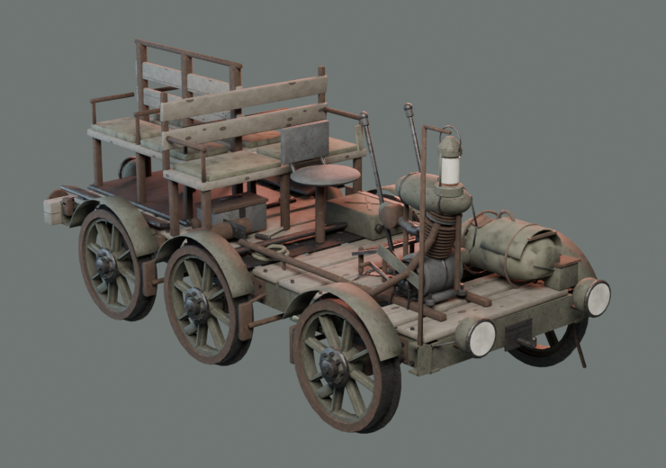
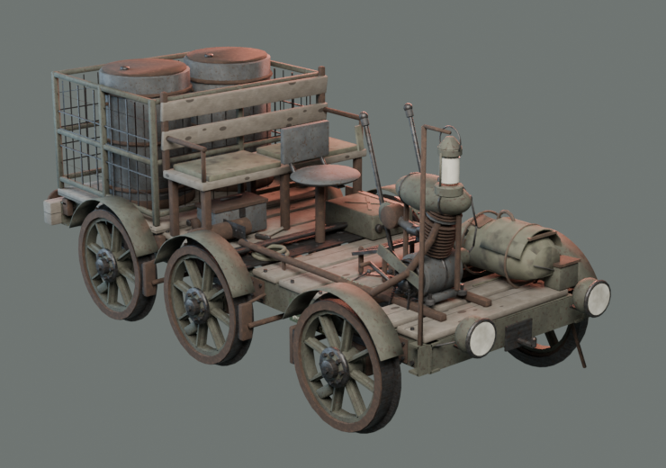
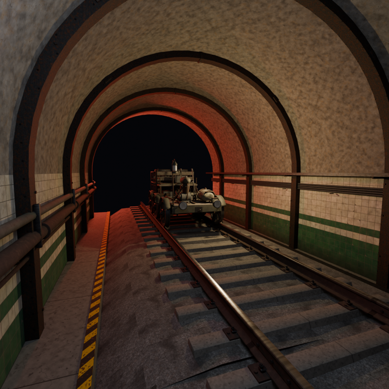
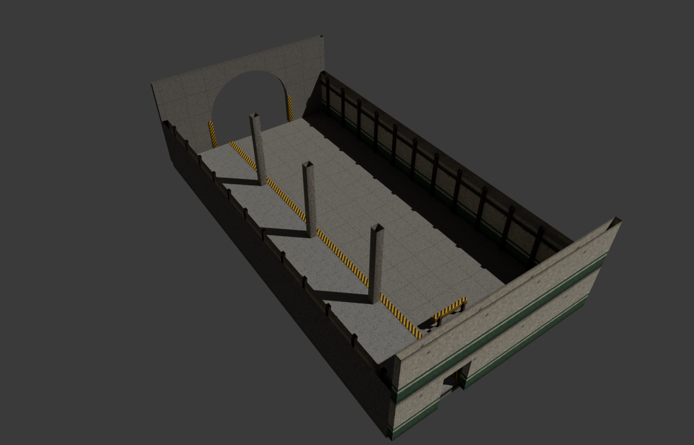
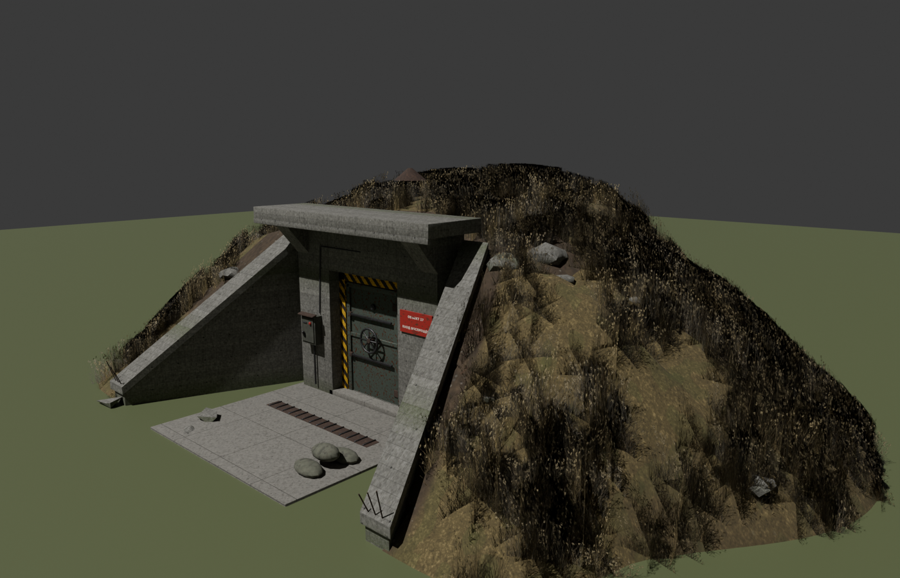
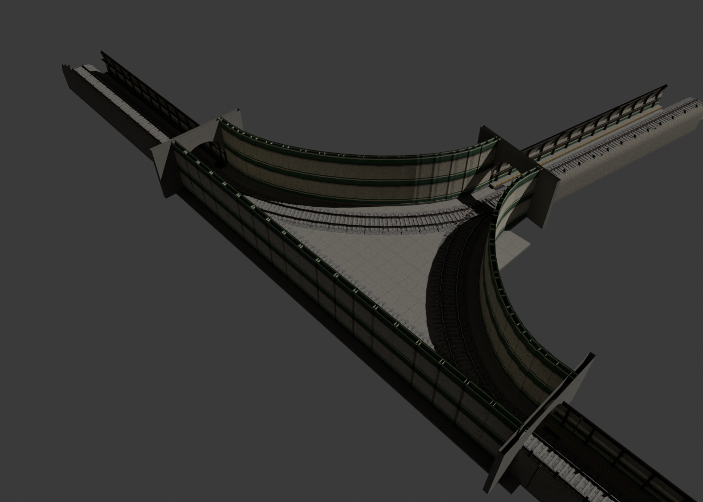
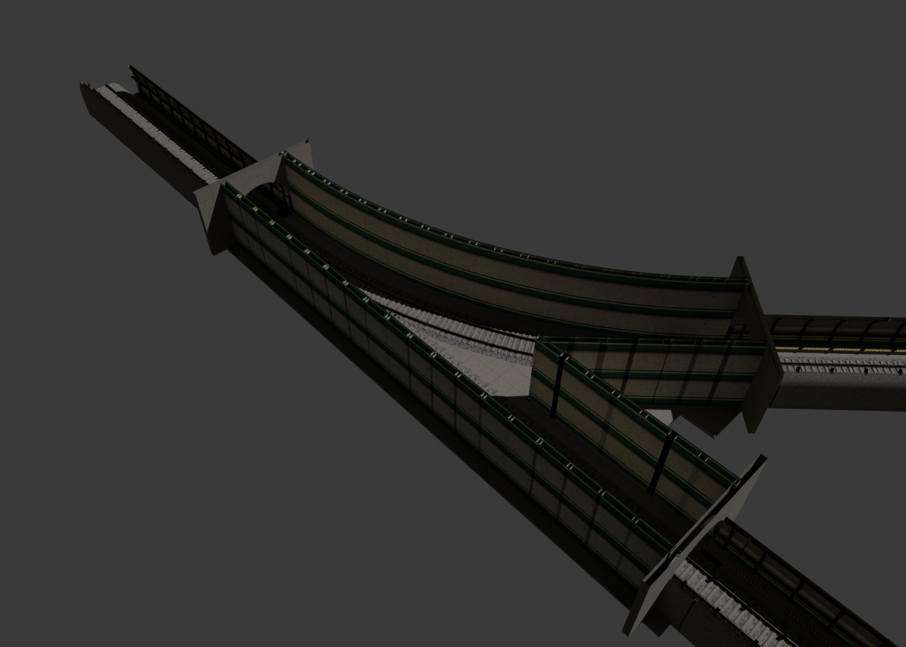
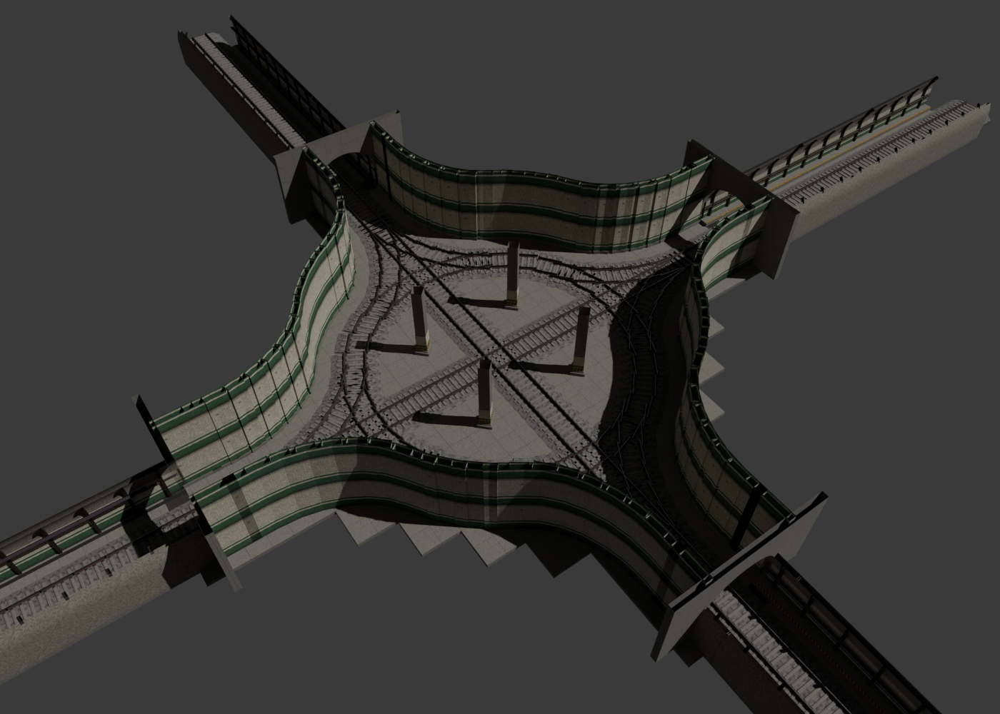

# Drezina — метро и мотодрезина для DayZ



Мод для DayZ 1.30, ставится на сервер и на клиенты. Админ прокладывает **метро** командами из чата,
остальное мод строит сам:
- вход-бункер на поверхности, лестница, станция, тоннель с рельсами;
- залы развязок со стрелками там, где линии пересекаются или примыкают друг к другу.

У станций стоят терминалы выдачи **мотодрезин**. Всё сохраняется и восстанавливается после рестарта.

## Мотодрезина

| С лавочкой | С бочками |
|---|---|
|  |  |

`Drezina_Motor` — машина DayZ, которую по рельсам ведёт скрипт.

### Выдача и сдача
- Берётся на терминале выдачи («Взять мотодрезину»), подаётся с полным баком и свечой. Аккумулятор не нужен.
- Пустую дрезину можно сдать на терминале.

### Управление
- **W** — газ, **S** — тормоз, передача **R** — назад.
- На стрелках руль **A/D** выбирает ветку. Если руль не трогать, у конца линии с двумя съездами дрезина уходит направо.
- Дозаправка — канистрой или бутылкой с бензином («Заправить мотодрезину»).

### Устройство
- Схема осей 0-00: спереди мотор и одна ось, сзади две.
- Фары разбиты. Висящий фонарь всегда тускло светит вокруг дрезины.
- У водителя сиденье на стойке, рычаги газа и тормоза, подставка под ноги. За руль садятся с любого борта.
- За водителем лавка на двоих и сумка на 10×6.

### Модуль на задней части
Слот «Модуль» в инвентаре дрезины. Модуль берут в руки у терминала выдачи и перетаскивают в слот.

| Модуль | Что даёт |
|---|---|
| **Лавочка** (`Drezina_ModuleBench`) | ещё 4 места, по двое лицом наружу; пересаживаться можно только к соседу на своей стороне |
| **Две бочки** (`Drezina_ModuleBarrels`) | две бочки-хранилища 10×10 в стальном каркасе с сеткой |

- Снять модуль нельзя, пока на лавочке кто-то сидит или в бочках что-то лежит.
- Ненужный модуль сдают обратно на терминал («Сдать модуль»).

### Урон и ремонт
- **Наезд.** Дрезина бьёт игроков, заражённых и зверей перед собой. Урон растёт со скоростью, на 50 км/ч насмерть.
- **Удар.** Удар в другую дрезину или в глухой торец пути ранит обе дрезины, а людям на борту отнимает немного здоровья и шока.
- **Поломка.** Когда здоровье почти кончилось, дрезина сломана: мотор глохнет и не заводится.
- **Ремонт.** Горелка с газовым баллоном в руках, «Починить мотодрезину», 15 секунд.

### Прочее
- Заражённые и мутанты не агрятся на игрока на дрезине и под землёй.
- Пока за рулём игрок, когда остановиться перед другой дрезиной или у торца пути, решает его клиент.
  Серверная копия держится за ним в пределах 1,5 м. Без этого клиента откатывало назад, будто он ударился о «невидимую стену».

## Метро

| Тоннель | Станция (в разрезе) | Вход-бункер |
|---|---|---|
|  |  |  |

- У каждого конца линии стоит бункер-вход с гермодверью, за ним лестница и коридор.
  Ниже — станция с платформой, колоннами и терминалом выдачи.
- Под землёй темно, горят только красные вращающиеся аварийные маячки.
- Шаги по полу метро звучат как по бетону.
- Все подземные линии стоят на **одном уровне пола**, поэтому любые две могут пересечься. Если новой линии
  нужно глубже, остальные линии опускаются вместе с ней, вместе с путями.
- Станция и первые ~14 м тоннеля за ней всегда прямые: точка `via` рядом со станцией не даёт щели у портала.
- Если под землёй пол ушёл бы ниже уровня моря (берег, низины), тоннель строится «в локации за картой»
  над морем, в той же форме. Для игрока разницы нет: входы стоят там, где их поставил админ.

### Развязки

| Т-развязка, два съезда | Т-развязка, один съезд | Пересечение с кольцом |
|---|---|---|
|  |  |  |

Картинки — виды сверху, срезанные на высоте 3 м.

- **Т-развязка.** Конец новой линии подведён к существующей. Ветка почти поперёк — два съезда, налево
  и направо. Ветка под острым углом — один, в ту сторону, куда она смотрит. Стены идут по внешней
  стороне съездов, внутри развилки открытый пол.
- **Пересечение под большим углом** — зал с кольцом: съезды с обеих линий на кольцо, стены изгибаются
  между ветками, внутри кольца бетонные колонны под свод.
- **Пересечение под острым углом** — круглый зал с двумя съездами между линиями.
- Пол и потолок развязок выложены плитами только внутри стен.

## Команды админа

Команды пишутся в чат. В общий чат они не попадают, их получает только сервер.

### Метро

```
/metro a            вход здесь
/metro via          точка поворота здесь (по желанию, сколько нужно)
/metro auto 25      точка поворота каждые 25 м, пока идёте (/metro auto 0 — выключить)
/metro b            выход здесь
/metro info         длина и где будет тоннель
/metro build        построить
```

| Команда | Что делает |
|---|---|
| `/metro a` / `via` / `b` | вход / точка поворота / выход там, где вы стоите |
| `/metro auto <м>` | точки поворота автоматически при ходьбе |
| `/metro undo` | убрать последнюю точку |
| `/metro info` | длина, число точек, режим |
| `/metro build [under\|zone] [глубина]` | построить: под землёй, в локации за картой или сам выберет |
| `/metro del [id]` | удалить ближайшее метро (до 40 м от входа) или по номеру, вместе с его путём |
| `/metro list` | список линий |
| `/metro tp a` / `b` / `<id>` / `<x> <z>` | телепорт к точке черновика, ко входу метро или по координатам |
| `/metro rebuild` | пересоздать объекты метро (после правок развязок и т.п.) |
| `/metro preset` | готовый маршрут для Черноруси (Старый Собор — Выбор) |

Конец линии рядом с другой линией подключается к ней Т-развязкой сам, станции на этом конце нет.

Советы:
- точки поворота ставьте не ближе 20–30 м друг к другу;
- первые ~30 м от входа ведите прямо.

### Рельсы на поверхности

| Команда | Что делает |
|---|---|
| `/rail new` | начать путь, первая точка здесь |
| `/rail add` / `auto <м>` / `undo` | добавить точку / ставить автоматически / убрать последнюю |
| `/rail done` / `cancel` | сохранить путь с терминалами выдачи / отменить черновик |
| `/rail extend` | продлить ближайший путь от ближайшего конца |
| `/rail del [id]` / `list` / `tp <id>` | удалить / список / телепорт к началу пути |
| `/rail take` | выдать дрезину у ближайшего конца пути (проверка без терминала) |
| `/rail reload` | перечитать настройки, админов и пути |

### Кто админ

Админы берутся из двух списков:
- `profiles/Drezina/admins.json` — Steam64 ID;
- суперадмины VPP Admin Tools — `profiles/VPPAdminTools/Permissions/SuperAdmins/SuperAdmins.txt`.

Обычным игрокам мод сообщений не пишет: ни в чат, ни уведомлениями. Их видят только админы,
остальное идёт в серверный лог. Подсказки на действиях («Сесть», «Взять модуль…» и т.д.) видят все.

## Файлы на сервере

| Файл | Что |
|---|---|
| `profiles/Drezina/settings.json` | настройки (пример в `profile_example/`) |
| `profiles/Drezina/admins.json` | свои админы |
| `profiles/Drezina/tracks.json` | пути (рельсы), сохраняются сами |
| `profiles/Drezina/tunnels.json` | линии метро, сохраняются сами |

Объекты метро и рельсы в CE-хранилище не пишутся, при каждом старте они создаются заново.

Основные настройки:
- `HandcarClearance` — зазор между дрезинами на пути;
- `MaxHandcarsPerTrack` — дрезин на один путь;
- `AbandonSeconds` — через сколько удалять брошенную дрезину;
- `MetroDefaultDepth` — на сколько метров пол ниже рельефа;
- `MetroMinFloorY` — ниже какой высоты пол не опускать;
- `MetroZoneX/Z/Y` — где локация за картой.

## Метро в админском КПК

Если на сервере стоит мод КПК (`grfgr/KPK`), в админском КПК-А «Куратор» есть вкладка **МЕТРО**:
- список линий с длиной и числом пересечений;
- у выбранной линии по порядку: начало, пересечения с другими линиями (кольцо, два съезда, Т-развязка), конец, у каждой точки квадрат;
- на карте рядом у каждой линии свой цвет, входы отмечены значком «M», пересечения — «✕». Клик по точке в списке приближает к ней карту.

Drezina объявляет `#define DREZINA` и отдаёт данные через `DrezinaMetroMap.CollectFull(lines, crosses)`
(есть и короткий вариант `Collect(lines, entrances)`). Жёсткой зависимости нет. Линии и пересечения сервер присылает
клиентам при входе и после `/metro build`, `del`, `rebuild`.

## Сборка

```
Drezina/                     папка аддона -> Drezina.pbo
  config.cpp                 классы мотодрезины, модулей, метро, развязок
  data/*.p3d, model.cfg      модели (готовые, собраны из Blender-скриптов)
  data/textures/             текстуры (.png -> .paa)
  scripts/3_Game             константы, настройки, геометрия пути
  scripts/4_World            пути, метро, развязки, мотодрезина, действия
  scripts/5_Mission          запуск, команды из чата
tools/blender/               генераторы моделей и экспорт в .p3d
tools/*.bat                  сборка на Windows
workshop/                    mod.cpp и превью для Мастерской
```

| Файл | Что делает |
|---|---|
| `tools\build_models.bat` | модели из Blender-скриптов в `Drezina\data` (нужен Blender 4.1+). Готовые `.p3d` уже лежат в репозитории |
| `tools\convert_textures.bat` | `.png` → `.paa` (ImageToPAA из DayZ Tools) |
| `tools\copy_to_p.bat` | копирует `Drezina` на `P:\Drezina` для Addon Builder |
| `tools\build_all.bat` | всё подряд |

Модели генерируются скриптами в `tools/blender/`:

| Скрипт | Модели |
|---|---|
| `motor_handcar.py` | мотодрезина и модули |
| `metro_bunker.py` | метро: вход, лестница, станция, тоннели, развязки (зал, стены, порталы, колонны, плиты), маячок |
| `track.py` | рельсы |

`export_p3d.py` пишет `.p3d` в формате Object Builder (MLOD): LOD, геометрия, Roadway, точки памяти,
тени. Лимит: LOD0 мотодрезины держите меньше ~50 тыс. граней, иначе игра не создаёт машину.

## Установка и Steam Workshop

1. **Упакуйте PBO.**
   - Запустите `convert_textures.bat`, потом `copy_to_p.bat`.
   - DayZ Tools → **Addon Builder**: исходник `P:\Drezina`, назначение `@Drezina\Addons`, с подписью своим ключом.
2. **Соберите папку мода:**
   ```
   @Drezina\
     Addons\Drezina.pbo
     Addons\Drezina.pbo.<ключ>.bisign
     Keys\<ключ>.bikey
     mod.cpp                <- из workshop\mod.cpp
   ```
3. **Опубликуйте.** DayZ Tools → **Publisher**:
   - New;
   - заголовок, описание;
   - превью — `workshop\preview.jpg`;
   - папка — `@Drezina`;
   - Publish.

   Обновление — тот же предмет, *Change notes*, снова Publish.
4. **Сервер:**
   - `.bikey` положите в `keys\` сервера;
   - добавьте `-mod=@Drezina` в запуск;
   - при первом старте появится `profiles/Drezina/`.

## Известные ограничения

- Метро «в локации за картой»:
  - погода внутри не отключена;
  - игрок, вышедший из игры в тоннеле, при входе окажется там же.
- Спавн мутантов задаёт мод карты: Drezina только запрещает им агриться под землёй и на дрезине.
- После изменения развязок или уровня пола выполните `/metro rebuild`.
