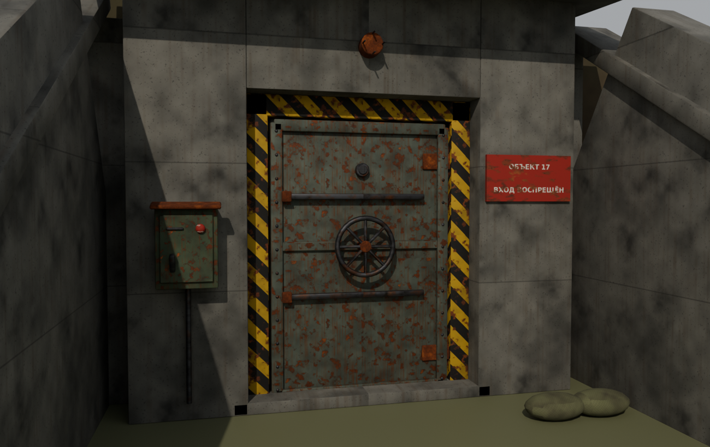
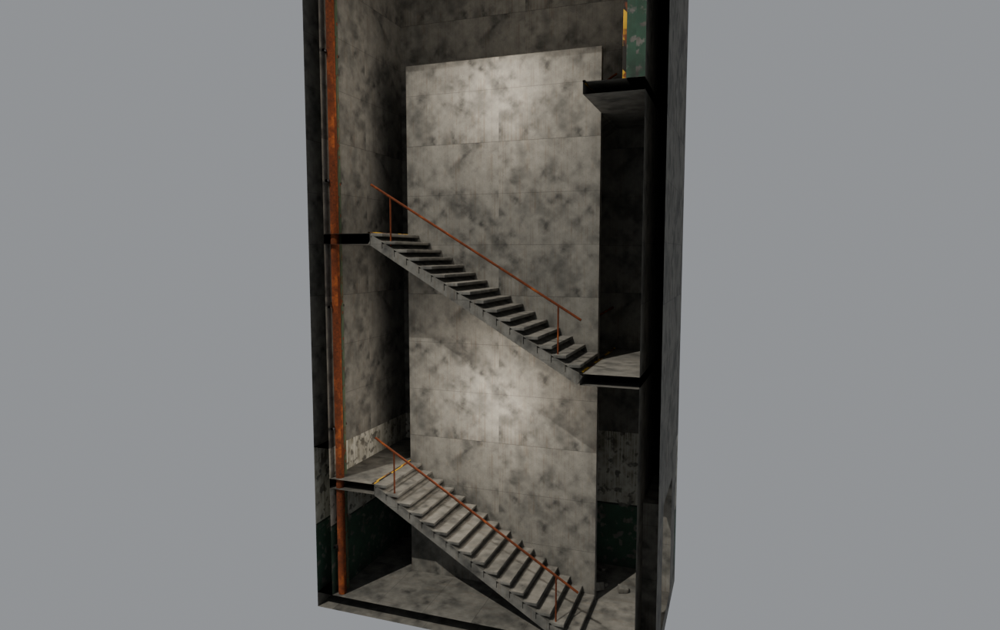
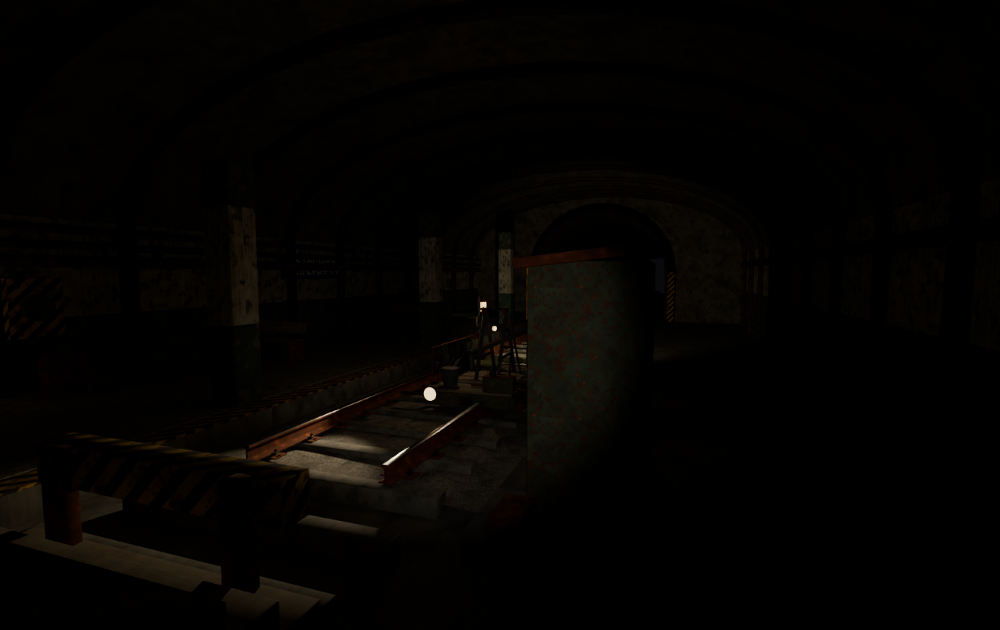
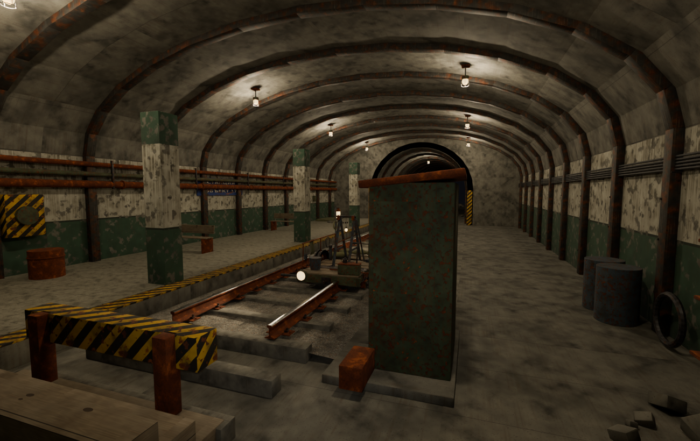
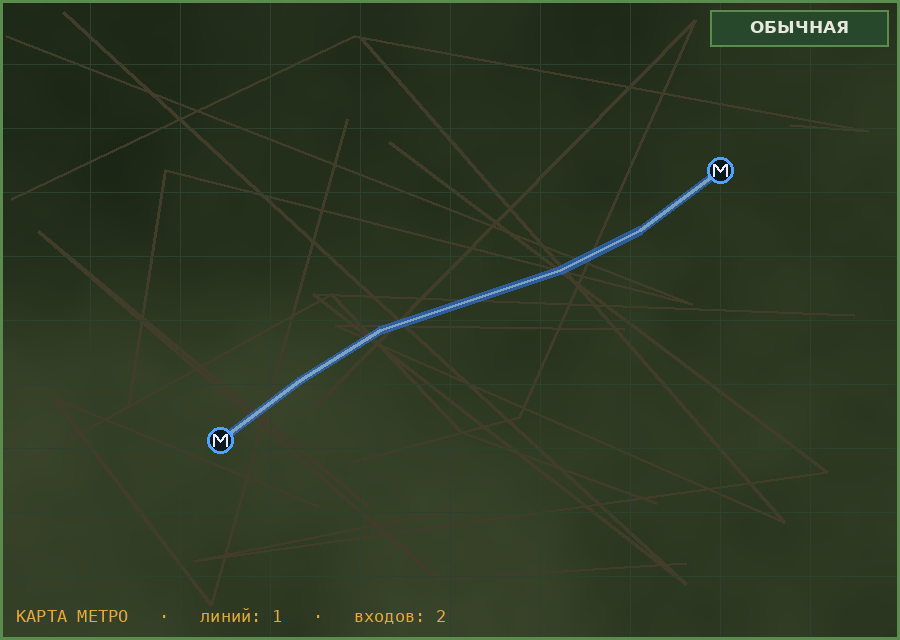
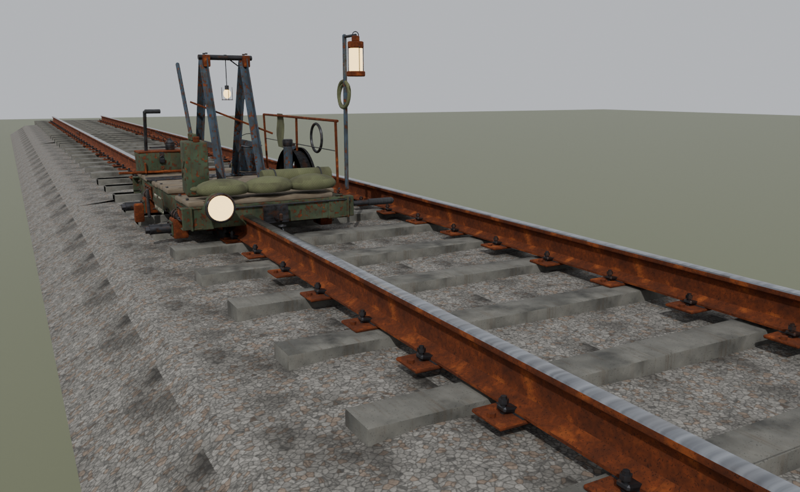
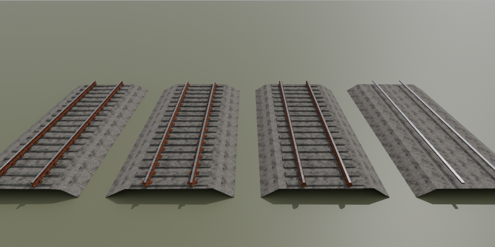
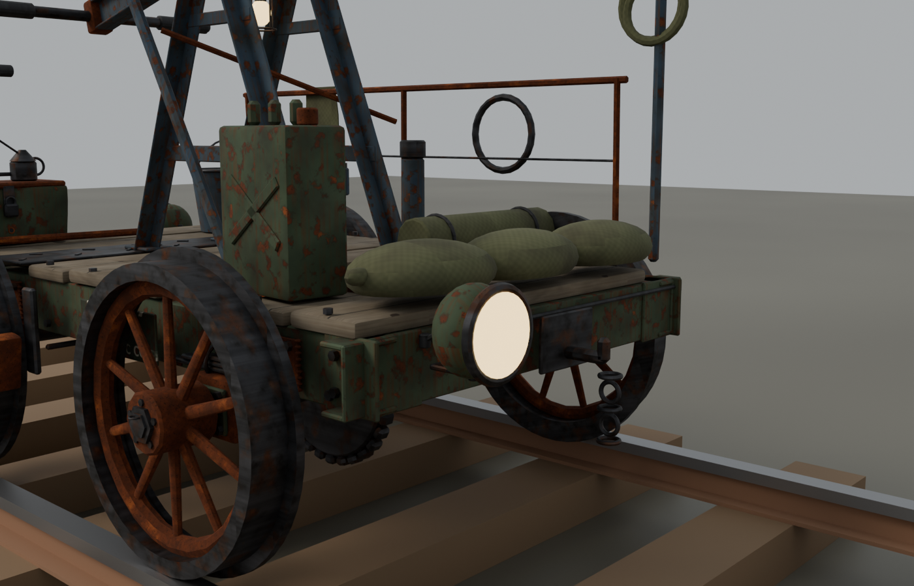

# Drezina — метро и мотодрезина для DayZ


Серверный мод для DayZ 1.30. Админ прокладывает **метро** командами из чата. Каждая линия — это:
- бункерные входы на поверхности;
- лестницы и станции;
- тоннели и рельсы внутри.

Там, где линии встречаются, сами строятся **залы развязок со стрелками**. У станций стоят терминалы
выдачи **мотодрезин**. На них ездят по рельсам: водитель и до шести пассажиров, плюс сумка и бочки для груза.
Всё сохраняется и восстанавливается при рестарте.

## Что умеет мод

**Мотодрезина** (`Drezina_Motor`, машина DayZ)
- Выдаётся на терминале с **полным баком**, дозаправка канистрой. Нужна свеча, аккумулятор не нужен.
- Едет только по рельсам: W газ, S тормоз, передача R — назад. На стрелках руль A/D выбирает ветку.
- Схема осей 0-00: спереди мотор и одна ось, сзади две оси. За водителем лавка на двоих.
- На удлинённой задней части — **слот «Модуль»**:
  - **лавочка** — ещё 4 места, по двое лицом наружу;
  - **две бочки** — два хранилища в стальном каркасе с сеткой.
- Модуль берут в руки у терминала («Взять модуль: лавочка / две бочки») и перетаскивают в слот «Модуль» в инвентаре дрезины.
- Ненужный модуль сдают обратно на терминал («Сдать модуль»).
- Снять модуль нельзя, пока на лавочке кто-то сидит или в бочках что-то лежит.
- Фары разбиты. Висящий фонарь всегда тускло светит вокруг дрезины, метров на два корпуса.
- За руль садятся с любого борта. На лавочке пересаживаются только к соседу на своей стороне.
- Пустую дрезину можно сдать на терминале.

**Метро**
- Линии строятся `/metro a … via … b` + `/metro build`. У каждого конца — бункерный вход, лестница, станция с терминалом.
- Все подземные линии стоят на **одном уровне пола**, поэтому любые две пересекаются. Если новой линии
  нужно глубже, остальные опускаются вместе с ней.
- Залы развязок строятся сами:
  - **крест** двух линий — кольцо или съезды;
  - **Т-развязка**, когда конец линии подходит к другой линии. Почти поперёк — два съезда (налево и
    направо), под острым углом — один. Пустая половина зала срезана прямой стеной.
- Станция и первые ~14 м тоннеля за ней всегда прямые: точка `via` рядом со станцией не даёт щели.
- Под землёй:
  - темно, горят только красные аварийные маячки;
  - шаги звучат как по бетону;
  - заражённые и мутанты не агрятся на игрока под землёй и на дрезине.

**Ручная дрезина и рельсы на поверхности** (`/rail`) остались: см. разделы ниже.

## Что внутри

```
Drezina/                      <- папка аддона, пакуется в Drezina.pbo
  config.cpp                  классы Drezina_Handcar, Drezina_Dispenser, Drezina_Rail
  data/model.cfg              скелет и анимации дрезины (качание рычага, вращение колёс)
  data/*.p3d                  модели — их нужно собрать (см. «Модели»)
  scripts/4_World/.../DrezinaTunnelManager.c   метро: тоннель, станции, входы
  scripts/3_Game              константы, настройки, геометрия пути (сплайн)
  scripts/4_World             менеджер путей, дрезина, станция, посадка, действия, управление
  scripts/5_Mission           запуск на сервере, перехват команд из чата
tools/blender/make_models.py  генератор моделей (дрезина, звено рельсов, станция)
profile_example/Drezina/      пример admins.json и settings.json
```

## Сборка на Windows (без Object Builder)

В папке `tools` лежат готовые `.bat`. Запускайте их **из папки репозитория** двойным кликом,
а не с диска P:.

| Файл | Что делает |
|---|---|
| `build_all.bat` | всё подряд: три файла ниже |
| `build_models.bat` | модели из Blender-скриптов, затем запись `.p3d` в `Drezina\data` (нужен Blender 4.1+) |
| `convert_textures.bat` | `Drezina\data\textures\*.png` → `.paa` через ImageToPAA из DayZ Tools |
| `copy_to_p.bat` | копирует папку `Drezina` на `P:\Drezina` для Addon Builder |

**Готовые `.p3d` уже лежат в `Drezina\data`.** Пока модели не менялись, Blender не нужен: достаточно
`convert_textures.bat` и `copy_to_p.bat`.

`.p3d` пишет `tools/blender/export_p3d.py` в том же формате, что сохраняет Object Builder (MLOD),
и упаковывает в каждую модель:
- уровни детализации (LOD);
- named selections;
- геометрию с массой и `autocenter = 0`;
- view- и fire-геометрию, Roadway;
- точки памяти;
- тень (у дрезины).

Addon Builder бинаризует их при упаковке.

## Установка на сервер

1. Соберите модели (см. ниже) и упакуйте папку `Drezina` в `@Drezina/Addons/Drezina.pbo`
   (DayZ Tools → Addon Builder, или pboProject). Подпишите pbo своим ключом, `.bikey` положите в `keys/`.
2. Добавьте мод в запуск сервера и клиента: `-mod=@Drezina`.
3. При первом старте создастся `profiles/Drezina/`. Впишите свой Steam64 ID в `profiles/Drezina/admins.json`.
4. Перезапустите сервер (или выполните `/rail reload`, если вы уже админ).

## Как админ прокладывает пути

Команды пишутся в обычный чат. В общий чат они не попадают, их получает только сервер.

| Команда | Что делает |
|---|---|
| `/rail new` | начать новый путь, первая точка там, где вы стоите |
| `/rail add` | добавить точку в том месте, где вы стоите |
| `/rail auto 4` | ставить точку автоматически каждые 4 м, пока вы идёте (`/rail auto 0` — выключить) |
| `/rail undo` | убрать последнюю точку |
| `/rail done` | сохранить путь: поставить рельсы и две станции выдачи |
| `/rail cancel` | отменить черновик |
| `/rail extend` | продлить ближайший путь от ближайшего к вам конца |
| `/rail del` / `/rail del 3` | удалить ближайший путь (до 15 м) или путь №3 |
| `/rail list` | список путей |
| `/rail tp 3` | телепорт к началу пути №3 |
| `/rail reload` | перечитать настройки, админов и пути с диска |

- Пока вы прокладываете путь, рельсы черновика видны сразу.
- Путь проходит ровно через точки, где стояли ваши ноги. Между точками линия сглаживается в плавную кривую.
  На поворотах ставьте точки чаще. Высота берётся тоже из ваших точек, поэтому работают и уклоны,
  и пути под землёй.
- Пути хранятся в `profiles/Drezina/tracks.json` и восстанавливаются при каждом старте. Рельсы и станции
  в CE-хранилище не пишутся, поэтому дубликатов не будет.

## Метро (заброшенный бункер)






Метро сделано в духе армейского бункера и заброшенной зоны: бетон в потёках, стены с облупленной
зелёной краской снизу и побелкой сверху, чугунные тюбинги, ржавые трубы, кабели, мусор.

### Свет от генераторов

Светильники висят на станциях, в коридорах, на лестницах и через каждые 30 м в тоннеле, но **сами
не горят**. На каждой станции, на бетонной площадке у глухой стены рядом с распределительным щитом,
стоит генератор (ванильный `PowerGenerator`). Чтобы дать свет:

1. залить в генератор бензин;
2. вставить свечу зажигания (`SparkPlug`);
3. включить генератор.

Пока он работает, горят светильники **своей станции, её коридора и лестницы и ближней половины
тоннеля**. Кончилось топливо, вынули свечу, выключили или утащили генератор дальше 6 м — свет гаснет.
Пропавший или уничтоженный генератор сервер ставит заново, пустой. Состояние генераторов
не сохраняется между рестартами: после рестарта их снова надо заправлять. Тип генератора задаётся
в `settings.json` (`MetroGeneratorType`).

### Станция



- **Слева платформа:** кафель, жёлтая кромка, колонны, скамейки, будка дежурного с разбитым окном
  и телефоном, табло «СТАНЦИЯ «ОБЪЕКТ 17»», часы, пожарный шкаф, телефон на стене, стоянка сталкеров
  с кострищем и матрасом. Ступенька ведёт к проходу в коридор.
- **Справа зона выдачи дрезин:** будка «ВЫДАЧА ДРЕЗИН» с окошком и рычагом, тупиковый упор пути
  в чёрно-жёлтую полосу, площадка под генератор и распределительный щит, стеллаж с запчастями,
  запасное колесо, бочки.

Как туда попасть:
1. На поверхности стоит **голова бункера**: бетонный блок в земляной насыпи, гермодверь со штурвалом
   в жёлто-чёрной окантовке, пульт с лампой, табличка «ОБЪЕКТ 17 · ВХОД ВОСПРЕЩЁН».
2. «Открыть гермодверь»: игрок открывает дверь (анимация и скрежет) и оказывается за ней,
   на верхней площадке лестницы. Рельеф DayZ нельзя прорезать, поэтому этот шаг — перенос.
3. Дальше всё пешком: **4 марша вниз** (9,6 м), коридор 8 м с трубами и щитком, станция.
4. На станции — путь и станция выдачи дрезины, за порталом тоннель.
5. Обратно: подняться по лестнице и у двери выбрать «Выйти наружу».

Что строится одной командой:
- тоннель по маршруту админа, с плавными поворотами;
- у каждого конца: голова бункера на поверхности, лестничная шахта, коридор, станция 24×12 м;
- путь внутри и станции выдачи дрезин у обоих концов.

На прямых участках тоннель собирается из звеньев по 10 м, на поворотах — из коротких 2-метровых
с нахлёстом, чтобы не было щелей.

### Где оказывается тоннель

| Режим | Когда | Что получается |
|---|---|---|
| **под землёй** | рельеф над всем маршрутом достаточно высокий | тоннель прямо под маршрутом, пол ниже самой низкой точки рельефа на 20 м |
| **в локации за картой** | берег, низины: под землёй пол ушёл бы ниже уровня моря, и игра считала бы, что игрок плывёт | тоннель той же формы и длины строится в отдельной локации над морем за краем карты |

По умолчанию (`/metro build`) режим выбирается сам. Можно задать явно: `/metro build under` или
`/metro build zone`. Для игрока разницы нет: он заходит в бункер на берегу, едет на дрезине
и выходит из бункера в городе.

Локация за картой по умолчанию находится в точке (17500, 500) на высоте 600 м, над морем восточнее
Черноруси. Положение задаётся в `settings.json` (`MetroZoneX/Z/Y`). Каждый новый тоннель в локации
ставится рядом с предыдущими и не пересекается с ними.

### Как проложить

```
/metro a            встать на месте входа
/metro auto 25      (по желанию) точка поворота каждые 25 м, пока идёте
/metro via          или ставить точки поворота вручную
/metro b            встать на месте выхода
/metro info         длина и где будет тоннель (под землёй или в локации)
/metro build        построить
```

Советы:
- На поворотах ставьте точки не ближе 20–30 м друг к другу, тогда поворот будет плавным.
- Первые и последние ~25 м от входов лучше вести прямо: там стоят станции.
- Маршрут идёт по ногам админа, поэтому его можно просто пройти пешком или проехать на машине
  с включённым `/metro auto`.

**Готовая раскладка для Черноруси:** `/metro preset` задаёт маршрут Старый Собор (5900, 7800) — Выбор
(3800, 8700), около 2,3 км по плато. Координаты примерные: проверьте места входов через
`/metro tp a` и `/metro tp b`, потом `/metro build`.

| Команда | Что делает |
|---|---|
| `/metro a` / `via` / `b` | вход / точка поворота / выход там, где стоите |
| `/metro auto <м>` | авто-точки поворота при ходьбе (`0` — выключить) |
| `/metro undo` | убрать последнюю точку |
| `/metro info` | длина, число точек, режим |
| `/metro build [under\|zone] [глубина]` | построить и сохранить (`tunnels.json`) |
| `/metro preset` | раскладка Старый Собор — Выбор |
| `/metro del [id]` | удалить ближайшее метро (до 40 м от входа) или по номеру, вместе с его путём |
| `/metro list` | список |
| `/metro tp a` / `b` / `<id>` / `<x> <z>` | телепорт к точке черновика, ко входу метро или по координатам |
| `/metro rebuild` | пересоздать объекты метро |

### Свои тоннели под картой

Пути `/rail` тоже ставятся на любой высоте, в том числе ниже рельефа (`ECE_KEEPHEIGHT`). Можно поставить
свои тоннели (DayZ Editor, свои `.p3d`), спуститься туда и проложить путь командами `/rail`.

### Карта метро в КПК



Если на сервере стоит мод КПК (`grfgr/KPK`), на модели «кирпич» во вкладке «Карта» есть кнопка
**МЕТРО**. Обычная карта затемняется, поверх рисуются полупрозрачные синие линии метро, входы помечены
кольцом с буквой «М». (Картинка выше — схема, а не снимок из игры.)

Drezina объявляет `#define DREZINA` и отдаёт данные через `DrezinaMetroMap.Collect(lines, entrances)`.
Другие моды тоже могут так рисовать метро на своих картах. Жёсткой зависимости нет: каждый мод
работает и без другого.

## Рельсы



Путь сделан как настоящий: рельс **Р65** с правильным профилем (подошва, шейка, головка) и
накатанной блестящей полосой сверху, **железобетонные шпалы** через 0,55 м, крепление **КБ**
(подкладка, резиновая прокладка, клеммы с болтами и гайками, закладные болты), стыковые накладки
на 10-метровых звеньях, **щебёночная призма**. Колея 1520 мм. Головка рельса стоит на 0,39 м выше
точки, где стоял админ (`RailHeightOffset`), поэтому шпалы ложатся на землю.

### LOD рельсов



Каждое звено пути собрано в четырёх вариантах. Уровни строятся отдельно, а не автоматическим
упрощением: при упрощении мелкий крепёж превращается в мусор, а здесь он на дальних уровнях просто убран.

| LOD | Расстояние | Что остаётся | Полигонов 10 м / 2 м | Файл |
|---|---|---|---|---|
| 0 | до ~25 м | всё: профиль Р65, шпалы с фаской, крепление КБ, накладки, призма | 6146 / 1366 | `rail_10m`, `rail_2m` |
| 1 | до ~70 м | профиль рельса из 8 точек, шпалы-бруски, только подкладки | 412 / 112 | `*_lod1` |
| 2 | до ~200 м | рельс из двух брусков, шпалы-бруски, грубая призма | 135 / 51 | `*_lod2` |
| 3 | дальше | призма и две полосы рельсов | 15 / 15 | `*_lod3` |

2 км пути — это ~200 звеньев по 10 м. Вблизи игрок видит LOD 0 только у ближайших 5–6 звеньев,
остальное рисуется LOD 1–3. В Object Builder положите файлы в Resolution LOD 0/1/2/3 одной модели
`rail_10m.p3d` (и так же `rail_2m.p3d`). Расстояния переключения движок считает сам по размеру
модели; если хочется раньше или позже, задайте значения Resolution LOD (например 0, 3, 8, 20).

## Ручная дрезина: как ездит игрок

(Старая ручная дрезина `Drezina_Handcar` для путей `/rail`. Терминалы метро выдают мотодрезину, см. ниже.)

1. Подходит к станции выдачи у конца пути и выбирает **«Взять дрезину»**. Дрезина появляется на рельсах
   у станции, носом в сторону пути, и игрок сразу встаёт за рычаг. Если у станции уже стоит свободная
   дрезина, игрок встаёт на неё, новая не создаётся.
2. Управление:
   - **W** — качать рычаг (разгон);
   - **S** — тормоз;
   - **R** — сменить направление (только на месте);
   - **F** — сойти.
3. У стоящей свободной дрезины есть действия **«Встать за рычаг»** и **«Сменить направление»**.
4. В конце пути дрезина останавливается сама. Дрезина на одном пути не въедет в другую.
   Брошенная дрезина исчезает через `AbandonSeconds` (по умолчанию 5 минут).

Скорость, разгон, торможение, влияние уклона, лимит дрезин на путь и прочее настраивается
в `profiles/Drezina/settings.json` (пример в `profile_example/`).

## Модель дрезины: слои

Генератор `tools/blender/handcar_zone.py` строит модель послойно:

1. **Силуэт.** Рама из швеллеров, пол из досок, колёса со спицами, оси. Размеры совпадают со скриптом.
2. **Механизм.** А-стойка из уголка, стальное коромысло-двутавр, шатун, шестерни с зубьями, буксы
   с листовыми рессорами, ручной тормоз с колодками, сцепные крюки, цепь.
3. **Износ и самодел.** Сварные заплатки, ряды болтов и заклёпок, пропавшая доска и доска, заменённая
   рифлёным листом, поручень из арматуры, керосиновый фонарь на штанге, ящик с инструментом и монтировка,
   мешки с песком вместо буфера, скатанный брезент, моток проволоки, изолента на ручках, табличка «ДР-17».
4. **Материалы.** Процедурные текстуры: облупленная зелёная и синяя краска с ржавчиной под ней,
   ржавчина, рассохшееся дерево, сталь с мазутом, изолента, брезент, табличка с трафаретом.
   UV-развёртка кубом, около 1 м на тайл.
5. **Крепёж и сварка.** Сварные швы по краям заплаток, угловые косынки рамы, гайки, шайбы и шплинты
   на концах осей, пресс-маслёнки на буксах, U-болты рессор, гайки ступиц колёс.
6. **Быт путевого обходчика.** Маслёнка с длинным носиком, ведро с песком, канистра, навесной замок
   на ящике, термос, моток верёвки на штанге фонаря, тряпка на поручне.
7. **Повреждения.** Вмятины на листовом металле (кожух шестерни, ящик, рифлёный лист), пулевые
   отверстия с вывороченными краями, расщеп обломанной доски.

**Без видимых граней.** У всех брусков фаска, у цилиндров до 32 граней, спицы — овальные конусы.
Всё сглажено по углу 35°: криволинейное выглядит гладким, плоское остаётся плоским.

| LOD | Полигонов | Файл |
|---|---|---|
| 0 (вблизи) | ~24 000 | `handcar` |
| 1 | ~13 000 | `handcar_lod1` |
| 2 (издалека) | ~2 300 | `handcar_lod2` |

В Object Builder положите их в Resolution LOD 0 / 1 / 2. Selections в LOD 1 и 2 сохраняются,
поэтому анимации там тоже работают.

### Свет от генератора (слой 8)



На дрезине самодельное освещение, будто его прикрутил местный умелец. Велосипедная динамо-машина трётся
о заднее левое колесо, провода на изоленте идут по раме к двум старым автомобильным фарам (вперёд и назад)
и к голой лампочке в клетке под стойкой.

- Свет включается сам, как только дрезина поехала, и гаснет, когда она встаёт.
- Яркость растёт со скоростью. На малом ходу генератор «не тянет», и свет тусклый и мигает.
- Пока свет горит, слышно подвывание динамо.

Нужны memory-точки `light_front`, `light_front_dir`, `light_back`, `light_back_dir`, `light_bulb`.

### Текстуры

```
python tools/textures/make_textures.py Drezina/data/textures 1024
```

В `Drezina/data/textures/` уже лежат готовые `*_co.png` и `*.rvmat` (материал Super). PNG сконвертируйте
в `.paa` через DayZ Tools → ImageToPAA. У каждого материала в Blender записаны пути `dayz_texture`
и `dayz_rvmat` для назначения в Object Builder.

## Звук

Готовые `.ogg` лежат в `Drezina/sounds/`. Они синтезированы скриптом `tools/sounds/make_sounds.py`,
сторонних сэмплов нет.

| Звук | Когда играет |
|---|---|
| `roll_loop` | гул качения; громкость растёт со скоростью |
| `clack_1..3` | «та-так» на стыках рельсов, каждые 12,5 м: сначала передняя ось, потом задняя (зависит от скорости) |
| `creak_1..4` | скрип коромысла в крайних точках хода; на накате рама изредка поскрипывает сама |
| `knock_1..2` | стук рычага в крайнем положении, когда качают |
| `brake_loop` | визг колодок при торможении (S) |
| `dynamo_loop` | подвывание динамо-машины, пока горят фары |
| `door_open` | гермодверь: лязг засовов, скрежет петель, удар |

Звуки трёхмерные, их слышат все игроки рядом. Если звук не устраивает, параметры синтеза легко поменять
в `make_sounds.py` и перегенерировать.

## Модели

Бинарные `.p3d` собираются только в инструментах DayZ на Windows, поэтому в репозитории лежит
генератор исходников:

```
blender --background --python tools/blender/make_models.py -- build_models
```

На Windows проще запустить `tools\build_models.bat` (двойной клик): он сам находит Blender
(нужен 4.1 или новее) и складывает результат в `build_models`.

Он создаёт в виде `.blend` и `.fbx`: `handcar` (через `handcar_zone.py`), `rail_2m`, `rail_10m`, `dispenser`,
а для метро (через `metro_bunker.py`) — `bunker_entrance`, `bunker_inner_door`, `bunker_stairs`,
`bunker_corridor`, `metro_station`, `tunnel_10m`, `tunnel_2m`, `dispenser`, `tunnel_lamp`;
рельсы (через `track.py`) — `rail_10m`, `rail_2m`. Дальше:

1. Импортируйте в Blender с аддоном **DayZ/Arma Toolbox** или откройте FBX в **Object Builder**.
2. Пустышки `mem_*` — точки для **Memory LOD**. Перенесите их без префикса: `lever_axis` (2 точки),
   `axle_front`, `axle_rear`, `seat_driver`, `light_front`, `light_front_dir`, `light_back`,
   `light_back_dir`, `light_bulb`.
3. Named selections уже заданы vertex-группами: `lever`, `wheel_fl`, `wheel_fr`, `wheel_rl`, `wheel_rr`, `body`.
4. **Geometry LOD** (столкновения): объекты `geometry_*` в каждом файле — готовые боксы для него
   (пол, стены и свод тоннеля, станции и павильона). Перенесите их в Geometry LOD и задайте массу.
   Для метро продублируйте их в **View Geometry**, **Fire Geometry** и **Roadway LOD**. Без них игрок
   провалится сквозь пол станции. На лестнице вместо ступеней в геометрии стоят наклонные пандусы
   (`geometry_ramp*`), по ним персонаж ходит плавно.
   **Важно:** у моделей метро в Geometry LOD задайте свойство `autocenter = 0`. Иначе движок сместит
   центр модели, и станция, коридор и лестница не состыкуются.
5. Сохраните каждую модель в `Drezina/data/<имя>.p3d` (имена как у файлов выше). Текстуры `.paa`
   по материалам `drezina_*` (дерево, сталь, железо, ржавчина) создаются в DayZ Tools → ImageToPAA.

Оси в Blender: Z вверх, Y вперёд, у рельса origin на уровне головки рельса по центру колеи.
Колея 1520 мм.

## Анимации

**Дрезина (готово).** `data/model.cfg` описывает скелет и две анимации:
- `drezina_lever` — коромысло качается на ±22°;
- `drezina_wheels` — колёса вращаются.

Скрипт на клиенте каждый кадр задаёт их фазу: колёса крутятся строго по пройденному пути, рычаг качается
с частотой, пропорциональной скорости, и при разгоне с места.

**Персонаж.** Игрок стоит на платформе за рычагом и едет вместе с дрезиной. Это делает скриптовая
команда `DrezinaRideCommand` (`HumanCommandScript`). Сейчас поза — обычная стойка. Своей анимации
качания рычага руками пока нет. Для неё нужно:
1. сделать `.rtm` в Blender (скелет DayZ, DayZ Animation Toolbox): цикл «наклон с ручкой вниз — вверх»
   длиной один период рычага;
2. добавить её в анимграф персонажа через DayZ Workbench (Animation Editor) как новую команду;
3. запускать её в `DrezinaRideCommand.PreAnimUpdate()`, места для этого отмечены комментариями.

Готовые `.rtm` и анимграф — бинарные ресурсы Workbench, из этой среды их не собрать.

## Известные ограничения

Мод проверен на тестовом сервере (DayZ 1.30, карта NHChernobyl).

- Метро «в локации за картой»:
  - погода внутри не отключена, может идти дождь;
  - игрок, вышедший из игры в тоннеле, при входе окажется там же. Если такое метро удалить, игрока
    придётся вытащить вручную.
- Спавн мутантов зависит от мода карты: этот мод только запрещает им агриться на игрока под землёй и на дрезине.
- Камера пассажира на лавочке (от третьего лица) висит над его местом. Если на вашей версии игры она
  уезжает, смотрите `Drezina_Motor.GetTransportCameraOffset`.
- После изменения развязок, лестниц или уровня пола выполните `/metro rebuild`: объекты метро перестроятся.

## Мотодрезина (машина)

Терминал выдачи подаёт мотодрезину `Drezina_Motor` (класс машины DayZ) с полным баком и свечой.

| Место | Кто |
|---|---|
| 0 | водитель (сиденье на стойке в центре, рычаги газа и тормоза, подставка под ноги) |
| 1–2 | лавка за водителем, лицом вперёд |
| 3–6 | модуль «лавочка» на задней части (3–4 слева, 5–6 справа, лицом наружу) |

Слоты:

| Слот | Что |
|---|---|
| `SparkPlug` | свеча |
| `DrezinaModule` | модуль: `Drezina_ModuleBench` или `Drezina_ModuleBarrels` |
| `DrezinaBarrel1-2` | бочки модуля «две бочки», появляются и исчезают вместе с ним; у каждой хранилище 10×10 |

У самой дрезины сумка 10×6.

Модели:
- `tools/blender/motor_handcar.py`:
  - мотодрезина;
  - модули как часть модели (выделения `module_bench` / `module_barrels`, их прячет анимация `hide`);
  - модули-предметы `drezina_module_*.p3d`.
- Кости экипажа `crewDriver`, `crewCargo1…6` и колёса трёх осей описаны в `Drezina/data/model.cfg`.

Важно про размер модели: LOD0 держим меньше ~50 тыс. граней. При ~59 тыс. игра не создавала машину
(«не удалось создать мотодрезину»).

## Публикация в Steam Workshop

Обложка лежит в двух вариантах:
- `docs/workshop_cover.png` — 1024×1024;
- `workshop/preview.jpg` — для Мастерской, меньше 1 МБ.

Иконки для лаунчера: `Drezina/data/textures/drezina_logo*_co.png`. Их переводит в `.paa` `convert_textures.bat`.

1. **Соберите PBO.**
   - Запустите `tools\convert_textures.bat` и `tools\copy_to_p.bat`.
   - В DayZ Tools → **Addon Builder**: исходник `P:\Drezina`, назначение `...\@Drezina\Addons`.
   - Включите подпись (*Sign output*) своим `.biprivatekey`.
   - На выходе получится `@Drezina\Addons\Drezina.pbo` и `.bisign` рядом.
2. **Соберите папку мода:**
   ```
   @Drezina\
     Addons\Drezina.pbo
     Addons\Drezina.pbo.<ваш_ключ>.bisign
     Keys\<ваш_ключ>.bikey
     mod.cpp            <- из workshop\mod.cpp
   ```
3. **Опубликуйте.** DayZ Tools → **Publisher**:
   - **New** — создать предмет;
   - **Title** — `Дрезина — метро и мотодрезина`;
   - **Description** — текст из раздела «Что умеет мод»;
   - **Preview Image** — `workshop\preview.jpg`;
   - **Content folder** — папка `@Drezina`;
   - **Tags** — Mod, Vehicle, Map;
   - **Visibility** — сначала *Private* или *Friends only*, чтобы проверить;
   - нажмите **Publish**, Steam попросит принять соглашение Мастерской.
4. **Обновление.** В Publisher выберите тот же предмет, заполните *Change notes* и снова нажмите **Publish**.
   ID предмета (в ссылке на страницу Мастерской) не меняется.
5. **Сервер.**
   - Скачайте мод из Мастерской или скопируйте `@Drezina` на сервер.
   - Положите `.bikey` в `keys\` сервера.
   - Добавьте `-mod=@Drezina` в запуск (вместе с остальными модами).
   - Клиенты получат мод через лаунчер по подписке.
