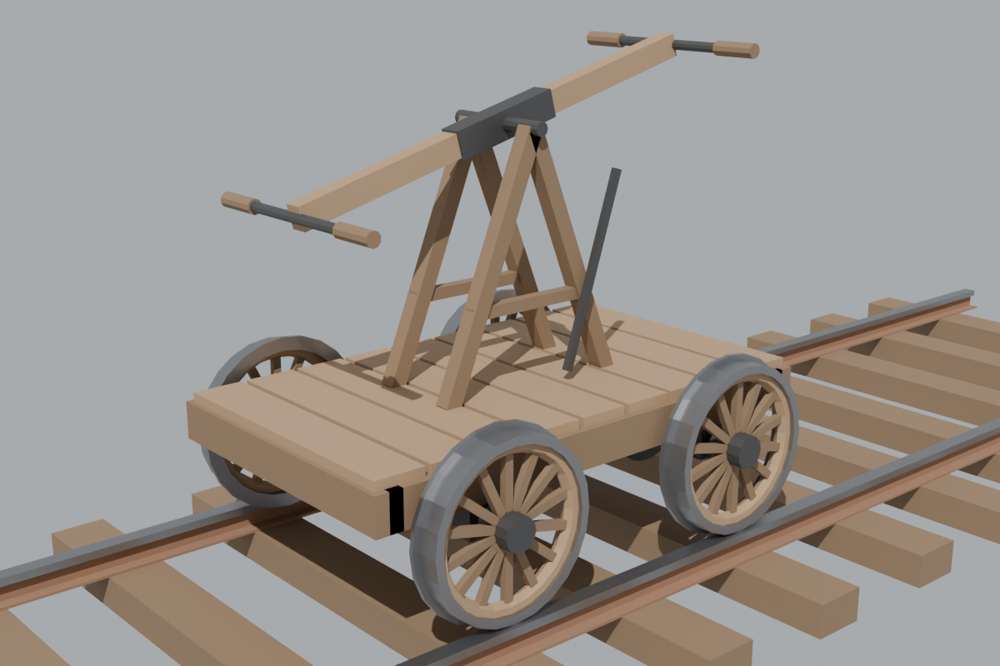

# Drezina — рельсы и ручная дрезина для DayZ

Серверный мод. Админ прокладывает рельсовые пути (например, по тоннелям метро под картой), пути сохраняются
навсегда. У каждого конца пути появляется станция выдачи: игрок подходит, берёт дрезину, она сама встаёт на
рельсы, игрок встаёт за рычаг и едет. Направление можно переключать.



Модель сделана по Sheffield Hand Car (~1890): деревянная платформа, колёса со спицами и стальным бандажом,
А-образная стойка, коромысло.

## Что внутри

```
Drezina/                      <- папка аддона, пакуется в Drezina.pbo
  config.cpp                  классы Drezina_Handcar, Drezina_Dispenser, Drezina_Rail
  data/model.cfg              скелет и анимации дрезины (качание рычага, вращение колёс)
  data/*.p3d                  модели — их нужно собрать (см. «Модели»)
  scripts/3_Game              константы, настройки, геометрия пути (сплайн)
  scripts/4_World             менеджер путей, дрезина, станция, посадка, действия, управление
  scripts/5_Mission           запуск на сервере, перехват команд из чата
tools/blender/make_models.py  генератор моделей (дрезина, звено рельсов, станция)
profile_example/Drezina/      пример admins.json и settings.json
```

## Установка на сервер

1. Соберите модели (см. ниже) и упакуйте папку `Drezina` в `@Drezina/Addons/Drezina.pbo`
   (DayZ Tools → Addon Builder, или pboProject). Подпишите pbo своим ключом, `.bikey` положите в `keys/`.
2. Добавьте мод в запуск сервера и клиента: `-mod=@Drezina`.
3. При первом старте создастся `profiles/Drezina/`. Впишите свой Steam64 ID в `profiles/Drezina/admins.json`.
4. Перезапустите сервер (или выполните `/rail reload`, если вы уже админ).

## Как админ прокладывает пути

Команды пишутся в обычный чат. В общий чат они не попадают, их получает только сервер.

| Команда | Что делает |
|---|---|
| `/rail new` | начать новый путь, первая точка там, где вы стоите |
| `/rail add` | добавить точку в том месте, где вы стоите |
| `/rail auto 4` | ставить точку автоматически каждые 4 м, пока вы идёте (`/rail auto 0` — выключить) |
| `/rail undo` | убрать последнюю точку |
| `/rail done` | сохранить путь: поставить рельсы и две станции выдачи |
| `/rail cancel` | отменить черновик |
| `/rail extend` | продлить ближайший путь от ближайшего к вам конца |
| `/rail del` / `/rail del 3` | удалить ближайший путь (до 15 м) или путь №3 |
| `/rail list` | список путей |
| `/rail tp 3` | телепорт к началу пути №3 |
| `/rail reload` | перечитать настройки, админов и пути с диска |

- Пока вы прокладываете путь, рельсы черновика видны сразу.
- Путь проходит ровно через точки, где стояли ваши ноги. Между точками линия сглаживается в плавную кривую.
  На поворотах ставьте точки чаще. Высота берётся тоже из ваших точек, поэтому работают и уклоны,
  и пути под землёй.
- Пути хранятся в `profiles/Drezina/tracks.json` и восстанавливаются при каждом старте. Рельсы и станции
  в CE-хранилище не пишутся, поэтому дубликатов не будет.

### Метро под картой

Мод ставит рельсы на любой высоте, в том числе ниже рельефа: объекты создаются с `ECE_KEEPHEIGHT`.
Сами тоннели и станции метро (стены, свод, спуски) — это отдельные модели или мапинг. Их надо поставить
заранее (DayZ Editor, свой `.p3d` тоннеля), потом спуститься туда и проложить путь командами выше.

## Как ездит игрок

1. Подходит к станции выдачи у конца пути и выбирает **«Взять дрезину»**. Дрезина появляется на рельсах
   у станции, носом в сторону пути, и игрок сразу встаёт за рычаг. Если у станции уже стоит свободная
   дрезина, игрок встаёт на неё, новая не создаётся.
2. Управление:
   - **W** — качать рычаг (разгон);
   - **S** — тормоз;
   - **R** — сменить направление (только на месте);
   - **F** — сойти.
3. У стоящей свободной дрезины есть действия **«Встать за рычаг»** и **«Сменить направление»**.
4. В конце пути дрезина останавливается сама. Дрезина на одном пути не въедет в другую.
   Брошенная дрезина исчезает через `AbandonSeconds` (по умолчанию 5 минут).

Скорость, разгон, торможение, влияние уклона, лимит дрезин на путь и прочее настраивается
в `profiles/Drezina/settings.json` (пример в `profile_example/`).

## Модели

Бинарные `.p3d` собираются только в инструментах DayZ на Windows, поэтому в репозитории лежит
генератор исходников:

```
blender --background --python tools/blender/make_models.py -- build_models
```

Он создаёт `handcar`, `rail_2m` и `dispenser` в виде `.blend` и `.fbx`. Дальше:

1. Импортируйте в Blender с аддоном **DayZ/Arma Toolbox** или откройте FBX в **Object Builder**.
2. Пустышки `mem_*` — точки для **Memory LOD**. Перенесите их без префикса: `lever_axis` (2 точки),
   `axle_front`, `axle_rear`, `seat_driver`.
3. Named selections уже заданы vertex-группами: `lever`, `wheel_fl`, `wheel_fr`, `wheel_rl`, `wheel_rr`, `body`.
4. Добавьте **Geometry LOD**: для дрезины подходит объект `geometry_deck`, для рельсов — низкий бокс.
   Массу задайте в Geometry LOD.
5. Сохраните как `Drezina/data/handcar.p3d`, `rail_2m.p3d`, `dispenser.p3d`. Текстуры `.paa`
   по материалам `drezina_*` (дерево, сталь, железо, ржавчина) создаются в DayZ Tools → ImageToPAA.

Оси в Blender: Z вверх, Y вперёд, у рельса origin на уровне головки рельса по центру колеи.
Колея 1520 мм.

## Анимации

**Дрезина (готово).** `data/model.cfg` описывает скелет и две анимации:
- `drezina_lever` — коромысло качается на ±22°;
- `drezina_wheels` — колёса вращаются.

Скрипт на клиенте каждый кадр задаёт их фазу: колёса крутятся строго по пройденному пути, рычаг качается
с частотой, пропорциональной скорости, и при разгоне с места.

**Персонаж.** Игрок стоит на платформе за рычагом и едет вместе с дрезиной. Это делает скриптовая
команда `DrezinaRideCommand` (`HumanCommandScript`). Сейчас поза — обычная стойка. Своей анимации
качания рычага руками пока нет. Для неё нужно:
1. сделать `.rtm` в Blender (скелет DayZ, DayZ Animation Toolbox): цикл «наклон с ручкой вниз — вверх»
   длиной один период рычага;
2. добавить её в анимграф персонажа через DayZ Workbench (Animation Editor) как новую команду;
3. запускать её в `DrezinaRideCommand.PreAnimUpdate()`, места для этого отмечены комментариями.

Готовые `.rtm` и анимграф — бинарные ресурсы Workbench, из этой среды их не собрать.

## Важно: что не проверено

Код написан без компилятора DayZ, а в игре его ещё никто не запускал. Перед боевым сервером
прогоните на тестовом. Самые вероятные места для правок:

- **`DrezinaConst.POSTPHYS_CONTINUE`.** Если игрок сразу «слетает» с дрезины после посадки,
  поменяйте значение на `false`.
- **Флаги создания объектов** (`ECE_NOPERSISTENCY_WORLD` и др.) и **сигнатуры vanilla-методов**
  (`ChatInputMenu.OnChange`, `PlayerBase.SetActions`). Если ваша версия DayZ отличается, компилятор
  скрипта сразу покажет строку с ошибкой.
- **Клавиши R/F во время езды.** Они совпадают с перезарядкой и взаимодействием. Если мешает,
  поменяйте `UAReloadMagazine` / `UAAction` в `DrezinaClientInput.c`.

Пока не сделано: пассажиры (на дрезине только водитель), стрелки и развилки, анимация персонажа (см. выше).
